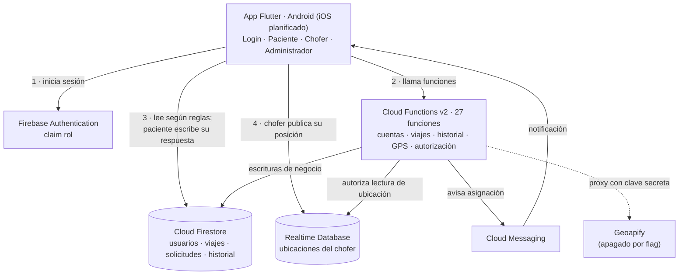
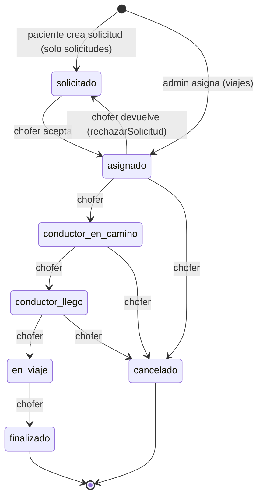
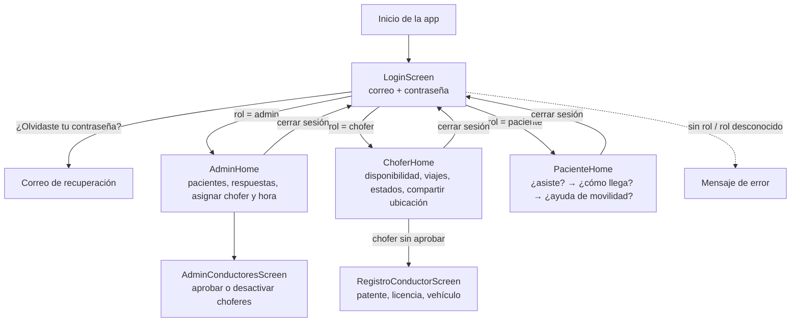

# Diseño de ingeniería — Dializa App (corte semana 9)

Los diagramas se construyeron a partir del código de `dializa-app/` (no de la
propuesta). GitHub los dibuja directamente (Mermaid). Cada sección indica qué
está **implementado** y qué está **propuesto**.

## 1. Arquitectura y responsabilidades

| Componente | Responsabilidad | Estado |
| --- | --- | --- |
| App Flutter | Interfaz por rol; lee su rol en `usuarios/{uid}` y abre la pantalla que corresponde | Implementado (Android probado en emulador; ver Anexo A) |
| Authentication | Identidad; custom claim `rol` usado por el servidor y por las reglas de RTDB | Implementado |
| Cloud Functions | Toda escritura de negocio: cuentas, viajes, historial, GPS, autorización, notificaciones | Implementado; probado con dobles |
| Firestore | Datos de negocio; el cliente solo escribe `respuestas_paciente/{uid}` | Implementado; reglas sin ejecutar en emulador |
| Realtime Database | Posición en vivo del chofer y autorización de lectura | Implementado; reglas sin ejecutar en emulador |
| Geoapify | Geocodificación, rutas y map matching mediante el servidor | Código existente, **apagado** (`GEOAPIFY_HABILITADO=false`); integración real en Etapa 4 |

**Geoapify no obtiene el GPS del dispositivo.** La posición del chofer viene del
sensor del teléfono (`ubicacion_actual.dart`); Geoapify solo convierte
direcciones en coordenadas y calcula rutas.

## 2. Modelo de datos (implementado)

```mermaid
erDiagram
  USUARIOS ||--o| CHOFERES_PRIVADO : "si rol = chofer"
  USUARIOS ||--o| RESPUESTAS_PACIENTE : "si rol = paciente"
  USUARIOS ||--o| VIAJES : "paciente (id del doc)"
  USUARIOS ||--o{ SOLICITUDES : "paciente pide"
  VIAJES ||--o{ HISTORIAL_VIAJES : "al cerrar o reasignar"
  SOLICITUDES ||--o| HISTORIAL_VIAJES : "al cerrar"
  HISTORIAL_VIAJES ||--o| GPS_VIAJES : "mismo viajeId"
  USUARIOS {
    string uid PK
    string rol "admin | chofer | paciente"
    string nombre
    bool activo
    bool aprobado "solo chofer"
    string fcmToken
  }
  CHOFERES_PRIVADO {
    string uid PK
    string patente
    string licencia
    string modeloVehiculo
    bool vehiculoAdaptado
    bool disponible
  }
  RESPUESTAS_PACIENTE {
    string uid PK
    bool asistira
    string comoLlega
    bool necesitaMovilidad
    string direccion
    string fecha
  }
  VIAJES {
    string pacienteId PK
    string viajeId
    string choferId
    string fecha
    string hora
    string estado
    array historial
  }
  SOLICITUDES {
    string id PK
    string pacienteId
    string conductorId
    map origen
    map destino
    map necesidades
    string estado
  }
  HISTORIAL_VIAJES {
    string viajeId PK
    string cierre
    string estadoFinal
    map gps "conteo, primerTs, ultimoTs"
  }
  GPS_VIAJES {
    string viajeId PK
    subcol muestras "id = timestamp"
  }
```

Además existen `rateLimits`, `auditoria` (solo servidor) y, en Realtime
Database, `ubicaciones/{uid}` con `lat`, `lng`, `timestamp`,
`pacienteAutorizado`, `viajeAutorizado` y `autorizacionVersion`.

Restricciones relevantes (implementadas en `firestore.rules`,
`database.rules.json` y `functions/`):

- `viajes/{pacienteId}` guarda solo la asignación **vigente**; cada cierre se
  copia a `historial_viajes` dentro de la misma transacción.
- `gps_viajes` acepta como máximo 50 muestras por llamada y 5000 por viaje, con
  marca de tiempo entre 15 minutos antes y 60 segundos después de la hora del
  servidor.
- `historial_viajes` tiene índices por `pacienteId` y por `conductorId`,
  ordenados por `archivadoEn` (`firestore.indexes.json`).

## 3. Máquina de estados del viaje (implementada en `functions/viajes.js`)

Solo el chofer asignado avanza el estado. Cualquier otra transición se rechaza
en el servidor (`failed-precondition`). Esto está cubierto por pruebas y por la
mutación M1 (`docs/evidencias/INFORME_PRUEBAS.md`).

## 4. Flujo de navegación de los tres roles

| Pantalla | Estado |
| --- | --- |
| Login, panel admin, gestión de conductores, panel chofer | Implementado; capturas en el Anexo A |
| Panel paciente | Implementado en código; **sin captura todavía** (no había cuenta de paciente de prueba) |
| Pantalla de inicio (splash) y restauración de sesión por rol | Propuesto (Etapa 2) |
| Solicitud de viaje del paciente, pendientes del chofer, historial del admin | Propuesto (Etapa 3); el servidor ya existe |
| Registro de vehículo (`RegistroConductorScreen`) | Implementado; se muestra dentro de `ChoferHome` mientras el chofer no está aprobado |
